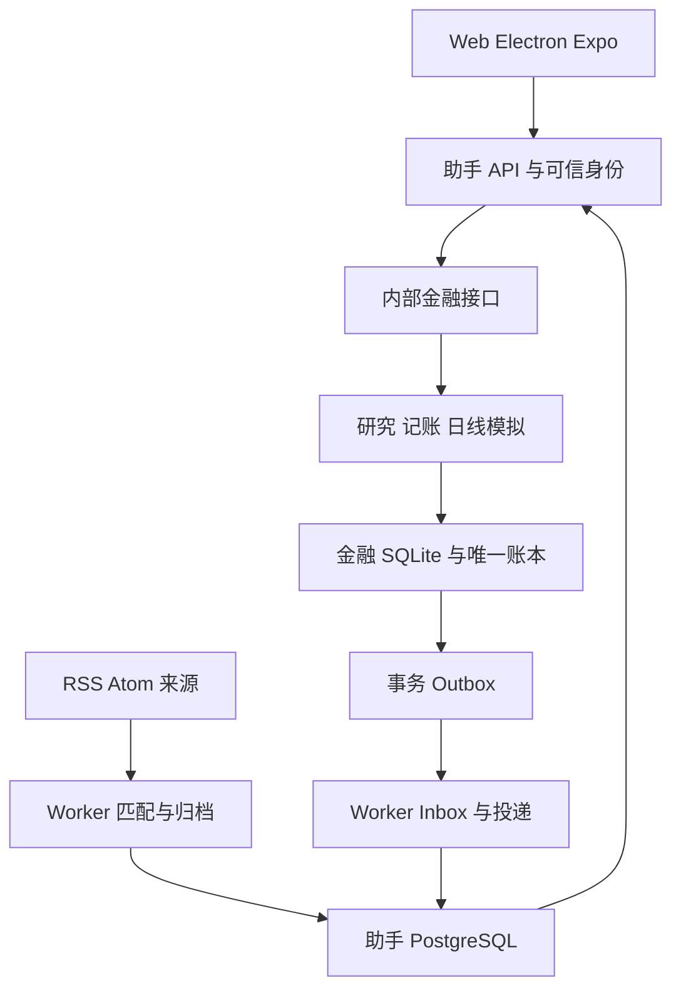

# MarketBot 系统架构

更新日期：2026-10-13

MarketBot 是一个面向股票与加密货币交易者的多端金融助手。多端应用
共享身份、严格业务契约、新闻档案和通知记录；独立金融引擎持有唯一金融
账本、研究任务及模拟执行。当前运行范围是开发版，能力按实际验收门禁开放。

## 服务与数据归属

| 模块 | 源码入口 | 责任与存储 |
| --- | --- | --- |
| Web / Electron / Expo | `apps/web`、`apps/desktop`、`apps/mobile` | 金融界面与原生交互；Electron 承载 Web；手机使用原生控件 |
| 助手 API | `apps/api` | 登录、严格 RPC、权限、能力查询与金融桥接 |
| 助手 Worker | `apps/worker` | RSS/Atom 同步、匹配、日报、金融事件消费、投递重试 |
| 共享契约 | `packages/contracts` | 资产、时间、十进制字符串、严格输入及可用能力 |
| 领域与适配器 | `packages/core`、`packages/adapters` | 金融接口、确定性匹配、档案与通知服务 |
| 助手数据库 | `packages/db` | PostgreSQL；用户、订阅修订、内容、日报、反馈、Inbox、观察与草稿 |
| 金融引擎 | `services/financial-engine` | AI-Stock Python/FastAPI；私有工作区 SQLite、金融账户、研究、日线模拟和 Outbox |
| 集成与运行工具 | `integrations/financial-engine`、`scripts` | 固定引擎、可重放补丁、运行环境、备份和隔离验收 |

金融引擎固定为 [AI-Stock 提交](https://github.com/EthanAlgoX/AIStock/tree/cec0078ca75aeb76ced28ae8bb0f1e22481d22d1)
`cec0078ca75aeb76ced28ae8bb0f1e22481d22d1`，在独立检出上应用集成补丁。
助手 PostgreSQL 不维护第二套现金、交易或模拟账本。适用许可和版权保留，
修改范围见 [修改说明](../MODIFICATIONS.md)。

## 身份、命令与事件

浏览器只调用已认证的助手 RPC。助手使用内部服务凭据、部署 issuer 与
用户 subject；金融侧保存可信工作区映射。客户端不能指定金融 owner、
工作区路径或数据库路径。无绑定或数据库丢失时拒绝访问，不自动重建空账户。

写命令使用稳定键、请求摘要和预期修订，金融写入与回执同事务提交。超时
后只查询原命令，确认不存在才按原编号重试。手机固定原账号、服务端点与
会话世代；退出或换端点后的旧异步操作不能交给新账号。

金融运行由单一进程推进。金融日线结果、真实订单/成交引用与 Outbox 同库
提交；助手持久化 Inbox、消费游标和通知。只有已记录的成交/拒单产生操作
提醒；估值只归档。重试通知不会重新运行策略，外部推送接受不等于手机送达。

## 金融与档案口径

新模拟使用 `state_json.decimalLedger` 作为金额权威，原 Float 列只提供兼容
派生视图。旧运行不能从 Float 自动重建精确账本。手工记账继续复用原
PortfolioAccount / Trade / CashLedger 的 Float 存储，并明确标记精度；
资金流水净额仅入金减出金，可用余额和实时市值未知。

模板交易先预览，再在修订与完整账本指纹一致时提交；重复编号同内容跳过，
冲突或交易日卖出超持仓阻断。模板不等于任意券商文件或实时账户同步。

内容修订、推荐和日报快照不可变，更正与反馈追加。订阅预览只读取缓存。
关联来源按相同原文链接或同 UTC 日精确标题生成候选，保留各来源观点，
不据此确认语义同事件或因果。留存范围见 [情报留存政策](INTELLIGENCE_RETENTION.md)。

研究任务预留物理模型用量预算，结算实际 usage；未知用量保留预留并阻断
后续调用。观察保存原报告快照、笔记、期限和手工失效条件，规则草稿保存
严格配置但不自动启动模拟。未实测的模型和股票行情保持关闭。

## 运行与验收

当前已验证本地登录、金融工作区、自选、模板记账、公开 RSS/Atom、每日档案
与 BTC 现货日线规则。累计相关回归为 503 项 Node、238 项金融测试通过；
这不代表所有平台或首版验收完成。模型研究与选股的实际输出、股票行情、
个人策略、手机真机投递、安装端体验及 72 小时持续运行仍待验证。

具体运行命令见 [本地开发](LOCAL_DEVELOPMENT.md)，证据与限制见
[运行验收](LOCAL_RUNTIME_VERIFICATION.md) 和 [实施记录](IMPLEMENTATION_LOG.md)，
后续工作按 [任务清单](IMPLEMENTATION_BACKLOG.md) 与 [规划方案](PROJECT_PLAN.md) 执行。
