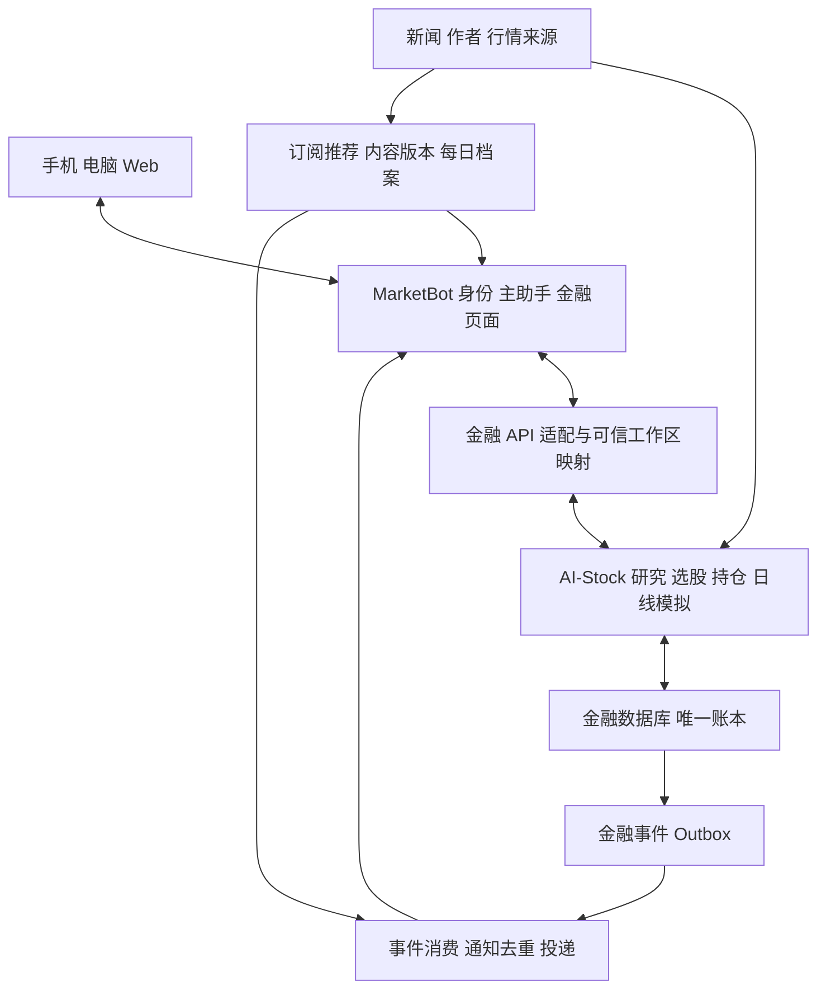

# 金融个人助手规划与设计方案

版本：v1.2

状态：自主实施中，能力按验收门禁开放

更新日期：2026-10-13

项目目录：仓库根目录

本项目面向同时关注股票和加密货币的个人交易者，提供手机与电脑共享的金融工作台。用户可以持续接收与自己有关的新闻和观点，研究资产，运行自己的模拟策略，并追溯当时收到的信息、策略判断和模拟交易结果。

第一版优先完成两条流程：**订阅信息 → 主动推荐 → 每日归档 → 复盘**，以及 **配置策略 → 后台日线模拟 → 模拟操作提醒 → 结果展示**。MarketBot 统一承载多端身份、金融页面、情报档案和通知，通过受控业务 API 接入独立 AI-Stock 金融引擎的研究、选股、持仓、信号和模拟服务。

本文件是后续开发的统一执行入口，覆盖产品需求、交互、系统分工、数据与接口、任务拆分和验收。已有能力先通过集成验证再开放；新接口及对象属于设计契约。当前服务边界见[系统架构](ARCHITECTURE.md)，产品名称和展示范围见[品牌规则](BRAND_GUIDELINES.md)。早期调研与历史方案已从产品目录移至独立研究资料目录。

## 如何执行本方案

开发按 M0 到 M5 的核心依赖推进，同阶段按任务前置条件执行；P1 不阻断后续 P0。每项任务记录依赖、产物和验收证据。任务清单位于[实施任务清单](IMPLEMENTATION_BACKLOG.md)，实际改动与验收见[实施记录](IMPLEMENTATION_LOG.md)。主方案定义范围与契约，任务清单记录执行状态，架构文档提供服务边界与源码入口；发生冲突时先更新主方案，再同步任务和验收。

P0 是首版发布必须完成的功能；P1 是核心流程之后的增强；P2 单独规划。阶段号表示依赖顺序，不代表工期。市场、设备、来源权限、预算和用户策略周期在 M0 确定；依赖这些选择的功能按实际验证结果实施，不将默认建议当作用户已确认。

每次开发先读取相关章节和任务，完成一个可验收的纵向流程，再更新状态与证据。范围变化记录原因、影响任务及验收，不仅修改代码。首版完成必须满足 P0 和 A01–A17，关键问题清零；本次文档交付不表示这些开发验收已经通过。

## 已明确的需求与规划假设

用户已明确要求：

- 手机端和电脑端都能使用。
- 主动推荐关注资产、市场、国内外宏观与微观信息。
- 按关注原因筛选博主内容，例如只订阅某个 X 博主的比特币观点。
- 新闻、观点、推荐和信号每天自动记录，便于检查与复盘。
- 支持股票筛选和单股、比特币等资产分析。
- 为策略提供专门的模拟运行空间，后台持续盯盘，并通知模拟买卖操作。
- 长期考虑真实账户同步及自动交易。

本版采用以下可调整的开发假设，尚不代表用户已经确认：

| 项目 | 首期建议 | 调整条件 |
| --- | --- | --- |
| 使用方式 | 个人自用，保留用户归属字段 | 如计划对外提供产品，再扩展多租户与协作 |
| 股票范围 | 先接入一个股票市场 | 用户确定 A 股、港股、美股或其他市场后选适配器 |
| 加密范围 | 先接入一个交易所的现货行情，优先覆盖 BTC | 若主要交易合约，需要提前加入保证金、杠杆、资金费和强平规则 |
| 策略形式 | 先验证 AI-Stock 支持的内置规则，再接入一至两个用户策略 | 任意 Python/DSL 策略需要新执行契约；自然语言 Skill 不等于确定性算法 |
| 运行频率 | 首期复用已完成日线的持续模拟；价格告警单独运行 | 用户策略若必须分钟/小时运行，将其列为专门扩展，不能沿用日线服务宣称已支持 |
| 手机提醒 | 后台服务持续运行，手机接收通知 | 真机权限、系统后台限制及投递结果需要实测 |
| 账户 | 复用 AI-Stock 记账及导入；模拟账户独立 | 记账账户不代表券商实时余额；完整只读同步需另核实 |
| 显示时间 | 默认 Asia/Shanghai，支持修改 | 交易时段按市场自己的时区和交易日历判断 |

第一期完成模拟交易，不接真实资金下单。实盘执行属于后续阶段，不能通过打开某个普通工具开关直接启用。

## 产品目标与首期边界

产品要帮助用户回答三个问题：今天有哪些信息与我有关，我的策略正在做什么，以及过去的判断和操作后来表现如何。

| 首期必须具备 | 后续扩展 |
| --- | --- |
| 自选资产、关注主题、博主订阅规则 | 多平台内容同步和复杂推荐模型 |
| 新闻与观点采集、去重、推荐理由、日档案 | 完整宏观数据库与跨市场事件分析 |
| 基础资产研究、条件筛选、手工持仓 | 多券商自动同步和完整财务研究体系 |
| 版本化策略、规则回测、持续日线模拟 | 分钟/小时策略、任意用户代码、合约、做空和复杂撮合 |
| 模拟账户、订单、成交、收益与回撤 | 人工确认实盘下单和限定策略自动交易 |
| 站内通知、移动推送、运行异常提示 | 多通知渠道和可配置升级提醒 |
| 信息到模拟交易的关联复盘 | 来源评价和经明确定义的观点表现统计 |

首期使用有限但真实可用的数据源。数据缺失或接入失败时，应显示覆盖范围、最近成功同步时间及失败原因。演示数据必须有明确标识，不用于宣称真实策略表现。

## 首版功能与优先级

| 编号 | 功能 | 等级 | 首版交付边界 | 对应验收 |
| --- | --- | --- | --- | --- |
| F01 | 多端身份与金融连接 | P0 | 选定电脑与手机访问同一可信绑定的金融工作区 | A01、A15 |
| F02 | 自选、记账持仓和个人偏好 | P0 | 完整资产身份、维护/导入、关注理由、数据时间；账户模式分开 | A01、A06 |
| F03 | 资产、市场、主题与作者订阅 | P0 | 至少一种验证可用的授权作者来源；作者与主题联合匹配及排除项 | A02、A05 |
| F04 | 新闻处理与推荐档案 | P0 | 去重、版本、来源、推荐理由、阅读反馈、不可变快照 | A03、A04 |
| F05 | 固定简报与主动提醒 | P0 | 配置时区和时间；站内记录、选定移动推送渠道、异常状态 | A04、A05、A11、A13 |
| F06 | 单资产研究与投资建议 | P0 | 发起任务、保存报告、证据/期限/失效条件、持仓上下文、观察事项 | A06、A16 |
| F07 | 条件选股与候选研究 | P0 | 支持字段、真实候选池、筛选快照、入选/排除依据、深研入口 | A06 |
| F08 | 规则日线模拟 | P0 | 至少一条支持的确定性规则、固定版本、账户、运行控制及检查原因 | A07–A10 |
| F09 | 模拟事件与结果展示 | P0 | 决策、拒绝、成交、异常通知；费用、净值和回撤；补记标识 | A09–A14、A16、A17 |
| F10 | 日档案与关联复盘 | P0 | 按日期/资产/运行查看当时快照，追溯真实关联并添加笔记 | A04、A12 |
| F11 | 常驻部署与运行健康 | P0 | 单一执行者、来源/任务状态、备份恢复及至少 72 小时验收 | A05、A08、A14、A15 |
| F12 | 用户策略适配 | 条件 P0 | M0 取得首条用户策略样例；不兼容现有规则时明确扩展工作量，禁止换成无关规则代替 | A07、A08 |
| E01 | 定时筛选/复查、价格与指标告警、周复盘 | P1 | 复用金融计划与告警，通知候选或判断变化 | 另补增强验收 |
| E02 | AI 历史回放入口、参数比较、更多来源及通知渠道 | P1 | 保留模型输出与偏差说明；增强不阻断规则模拟闭环 | 另补增强验收 |
| E03 | 分钟/小时策略、任意脚本、杠杆/合约、账户同步及实盘 | P2 | 每项单独定义数据、权限、成本、运行及执行模型 | 单独方案 |

作者平台无法接通时可用手工链接支持开发，但手工导入不能算作作者自动订阅已完成。需接入可用来源或明确调整首期范围。若用户首条策略必须盘中运行，M0 就调整执行范围，不到发布时才解释为只支持日线。

## 页面与多端设计

| 页面 | 首屏内容 | 主要操作 |
| --- | --- | --- |
| 今日 | 与持仓相关的变化、市场简报、订阅观点、策略动态、待关注事项 | 阅读、收藏、忽略、查看推荐依据、进入关联资产或策略 |
| 情报中心 | 新闻、公告、作者观点、研究建议、规则信号与历史推荐 | 按日期、资产、主题、来源和类型筛选；查看事件进展 |
| 资产研究 | 自选、持仓、候选股票、单资产研究与观察事项 | 设置筛选条件、生成研究草稿、维护观察理由、关联策略 |
| 策略实验室 | 策略列表、版本、回测、运行状态、条件检查记录 | 配置、校验、启动、暂停、停止、复制版本；比较运行为 P1 |
| 模拟账户 | 资金、仓位、净值、订单、成交、成本与基准 | 查看操作原因、查询订单状态、追溯策略和数据 |
| 复盘 | 日档案、事件时间线、观察笔记、策略与交易结果 | 按当时信息回看、添加复盘记录；周度汇总为 P1 |
| 设置 | 来源连接、订阅规则、时区、通知偏好、模型配置 | 管理权限、静默时段、数据同步及来源状态 |

电脑端采用侧栏导航，允许并排查看情报、研究和策略结果。手机端以“今日、研究、策略、复盘”为主要入口，情报筛选和模拟账户从对应页面进入。两端共享同一服务端状态和业务规则。

聊天作为各页面的辅助入口，支持“为什么推荐这条内容”“今天策略为什么没有买入”等上下文问答。聊天生成的策略或研究结论先展示为草稿，确认后的结构化配置才可运行。

### 页面状态与操作约束

| 页面 | 必须支持的状态 | 操作与结果 |
| --- | --- | --- |
| 今日 | 未设置、生成中、已生成、无匹配更新、部分来源失败、投递失败 | 阅读/收藏/忽略；点击通知进入原简报；补发只重试投递 |
| 情报与订阅 | 未连接、同步中、正常无更新、限流/失败、更正、原文失效 | 预览匹配、保存新订阅版本、启停；不删除已归档引用 |
| 研究与选股 | 数据缺失/陈旧、排队、运行中、完成/部分完成、失败、零候选 | 发起明确任务、查看原报告或筛选快照；只有后端支持时显示取消 |
| 策略 | 草稿、校验失败、已保存、启动/启停命令待确认、运行、暂停、停止、异常 | 保存不启动；超时查询命令结果；运行配置不能原地覆盖 |
| 模拟账户 | 无运行、有效/过期估值、待执行意图、拒绝、成交、延迟补记 | 查看账本和原因；首版不手改现金或成交，不显示未实现撮合操作 |
| 复盘 | 有档案、当天无档案、关联缺失、历史数据不可用、更正记录 | 编辑用户笔记；当时推荐及输入快照只读 |
| 设置与通知 | 权限未授予、设备注册失败、站内已记录、投递尝试中、服务商接受、失败 | 管理时间、静默时段与权限测试；服务商接受不显示为已读 |

页面分开显示业务数据截至时间、本次读取时间和最近任务成功时间。请求失败不能显示成零持仓、无新闻或零收益。

电脑支持完整订阅、研究、筛选及受支持规则表单。手机首版支持阅读、基本订阅设置、研究与候选查看、运行监控、暂停/恢复/停止、收藏和复盘；复杂策略编辑可明确提示转到电脑，两端使用同一规则和状态。

## 核心用户流程

### 初次设置

登录后检查金融连接和已验证能力，选择市场与资产，添加自选及可选记账持仓，配置主题/作者与关注理由，设置简报时间和时区，最后测试通知。设置可暂存；缺来源时显示未接通，行情或规则未验证时不开放模拟启动。通知授权与策略启动分别操作，推送权限被拒绝时仍保留站内记录。

### 作者主题订阅

选择来源和作者，填写关注原因、目标主题/资产及排除项，先预览真实样例的匹配、不匹配和待复核结果，再保存并开启订阅版本。例如“作者 A 的 BTC ETF 观点”可匹配，生活内容排除，未指向 BTC 的模糊市场观点留待复核。修改规则只影响后续推荐，历史简报继续引用旧版本。

### 每日简报

按配置时间冻结数据截止点，保存简报与推荐快照后再发通知。内容分为持仓关联、订阅观点、市场变化、候选变化和策略动态。没有匹配更新与来源抓取失败分别说明。补发复用原简报 ID，不重新生成历史内容；更正追加更新，旧摘要继续可查。

### 研究与选股

单资产先确定完整身份和数据覆盖，再发起研究；任务状态、原报告、引用和缺口可查，结果可加入观察或形成规则草稿。选股先确认候选池和可用字段，运行后展示可评估数、入选/排除原因，保存快照，再对候选深研。生成研究、保存观察和启动策略分别操作，模型建议不改变账本。

### 策略模拟

选择支持规则，配置资产、日线周期、资金、费用、滑点和仓位限制，通过校验后展示固定版本与运行摘要；点击启动才建立运行及账户。详情展示已完成日线、条件、未操作原因、待执行意图、拒绝、成交和净值。启停请求超时显示结果待确认并查询服务端，重复点击不创建第二个账户。

### 复盘

按日期、资产或运行查看当日原简报、研究或规则输入、决策、意图、订单、成交和后续结果，再添加用户笔记。只有已记录的关联才串成因果链路；规则成交没有关联研究时明确显示未关联，不自动补造报告来源。后验观察和笔记可追加，历史快照不可覆盖。

## 情报订阅与主动推荐

### 订阅对象

订阅规则同时支持资产、市场、主题和作者。每个作者可以绑定不同关注主题，例如“作者 A 的 BTC 和 ETF 内容”，并配置忽略广告、生活内容或不关注的资产。

国内外、宏观微观、语言和内容类型作为独立维度。系统保留原文来源并提供中文摘要，不因某篇内容讨论全球宏观就自动归类为某个具体资产的直接利好或利空。

### 信息处理流程

1. 来源适配器增量获取内容，记录来源 ID、链接、发布时间和首次获取时间。
2. 规范化资产与主题标识，识别新闻、公告、作者观点和模型分析。
3. 使用来源 ID 或内容指纹去重，再把同一事件的不同报道聚合。
4. 按订阅规则匹配内容，并检查是否与自选或持仓有关。
5. 生成摘要、推荐理由和重要程度，保留不同观点及待核实事项。
6. 保存推荐快照，按即时提醒、固定日报或仅归档三种方式投递。
7. 用户反馈用于调整偏好；不因用户常读某种立场而自动屏蔽反方观点。

首期使用可解释的排序规则：持仓相关程度、明确订阅匹配、新进展、时效性、来源可核实程度，以及用户反馈。相同事件的无实质更新进入日报；出现新的证据、策略条件变化或运行异常时，再触发即时提醒。各维度的权重作为配置，不把来源可信程度、模型提取把握和交易胜率混为一个数字。

### 推荐卡片与日档案

推荐卡片展示标题、内容类型、摘要、关联资产、推荐理由、来源、发布时间、首次获取时间和推荐时间。支持“已读、收藏、忽略、加入观察”和关联研究记录。

日报在指定时区的固定时刻生成，记录所含推荐的版本及顺序、推荐理由、订阅版本、持仓上下文和数据截止时间，形成可回看的日档案。后续更正和新进展追加为更新，不覆盖当时已推送的摘要。未读内容也保留推荐记录。

新闻和观点记录遵循来源的授权范围。不能长期保存正文时，保留允许存储的元数据、摘要、引用及来源链接，并记录失效或更正状态。

### 来源接入

首期优先接入有稳定接口或订阅能力的公告、新闻及作者来源。X 支持按作者获取帖子，但接入权限、费用、历史范围和可用频率需在选型时核实；不能承诺获取任意作者的全部历史内容。[X 官方时间线文档](https://docs.x.com/x-api/posts/timelines/introduction)

若某来源暂未接通，可以先手工添加链接用于归档与研究，页面明确显示“手工导入”。来源列表展示最近一次成功同步、覆盖时间范围、失败及下一次重试，避免把“没有新内容”和“没有成功获取内容”混淆。

## 新闻与信号记录

| 类型 | 含义 | 必须保留的依据 |
| --- | --- | --- |
| 新闻与公告 | 来源发布的事件或事实陈述 | 原始来源、时间、关联资产、核实或更正状态 |
| 作者观点 | 某人的判断、预测或交易思路 | 作者、观点摘要、原链接、明确的方向和期限（若有） |
| 模型分析与研究建议 | 助手基于已获得资料形成的分析或情景计划 | 引用内容版本、分析时间、模型或提示版本、假设、期限与失效条件 |
| 策略信号 | 确定性规则在指定数据上满足条件 | 策略版本、规则、行情时间、输入摘要、结果及有效期限 |

新闻或作者观点可以进入观察事项，但不直接生成自动买卖。首期策略信号由明确的规则计算产生。未来若设计事件驱动策略，必须额外定义事件提取、确认和失效规则。

AI-Stock 已有模型研究建议的结构化 DecisionSignal，拟保留其证据、期限、失效条件及后验观察。新助手另标记 `signal_kind` 和决策后端，把模型建议、确定性规则触发、价格告警分开；不能从名称中出现“signal”就判断可自动执行。

信号按“新产生、已提醒、已处理、过期、失效”记录状态，并与模拟订单建立关系。重复检查同一根 K 线或重放同一消息，不应产生重复信号和重复模拟订单。

## 持仓与资产研究

真实持仓与模拟持仓使用不同账户类型，界面始终显示账户及模式。首期真实持仓可通过 AI-Stock 的记账和 CSV 导入服务维护，保存数量、成本、费用、报价币种、数据截至时间和来源。无法确认成本或行情时显示缺失状态，不填入推测值。

统一资产标识应区分市场、标的、交易场所及报价币种，不单独使用显示名称作为唯一键。股票交易时段、复权和公司行为按选定市场与数据源处理；币对也不能仅凭“BTC”推断具体交易场所和计价币种。

资产研究页汇集行情、关联情报、研究草稿、持仓、策略与观察事项。每次分析保留数据时间、资料依据、假设、支持与反对观点，以及需要继续验证的事项。

首期选股采用明确的条件筛选，再由助手解释候选理由。条件只开放当前数据源实际提供的字段，例如市场、行业、成交活跃度或基础财务指标。缺失数据不自动当作零，也不自动判为满足条件。复杂财务研究、链上指标和跨市场排序后续扩展。

## 投资策略建议与选股闭环

策略建议分为三类：资产研究观点、结合持仓的情景计划，以及能够运行的规则策略。前两类复用 AI-Stock 的研究与结构化建议能力；第三类必须通过支持的执行后端校验，不能直接把报告中的“看多”转换成买单。

建议卡片包含适用资产、持仓背景、投资期限、支持与反对证据、观察或触发条件、失效条件、数据时间和可选仓位假设。价格区间必须有数据依据，资料不足时保留未知；不要求模型为每个问题强行输出精确买入价。模型自报置信度、选股评分和校准后的概率分别展示，不使用同一“胜率”标签。

用户可把建议加入观察、安排后续研究，或转成待校验的规则草稿。P0 对明确期限到期、已验证的结构化条件和新研究中已记录的判断变化更新状态并提醒；模糊语义的反证由新研究或用户记录确认，持续自动复查列为 P1。助手支持询问“什么变化会推翻这条判断”“这条建议与我的持仓有什么冲突”。

选股复用 AI-Stock 的快照、硬筛选、因子评分和可选模型解读。保存每次候选池、数据截止时间、筛选配置、排除原因和最终名单，再对候选深入研究。页面区分全量目录、实际可评估资产和模型看到的样本；不将有限名单称为全市场选股。Crypto 当前成交额候选池、历史冻结候选池和股票行业目录各自显示覆盖范围。

首版提供单次筛选及结果快照；增强阶段可按交易日定时运行，优先推送新进入候选、关键理由变化或失效项，保留完整结果用于复盘。首期数据和来源覆盖按 M0 验证结果开放，不因下拉框里有某市场就承诺其全部功能。

## 策略实验室

### 策略定义与版本

每条策略包含名称、说明、资产范围、市场、K 线周期、数据来源、指标参数、入场条件、退出条件、仓位规则、成本假设和适用的模拟成交模型。规则编辑器只开放已支持的条件，并校验所需数据、样本长度及相互冲突的参数。

自然语言输入先区分“AI 分析 Skill”和“确定性交易规则”。规则草稿展示触发与不触发的例子，检查并通过执行契约校验后保存为版本；AI Skill 保留提示、模型、工具和实际输出，不承诺每次产生相同判断。首期不直接执行模型生成的任意代码。用户已有策略需要先明确输入、周期、条件和实现形式，再选择结构化规则或独立策略适配器。

每次运行使用冻结的版本和配置。参数修改产生新修订及明确的执行会话，原版本、输入、信号、订单和结果保留；复用 AI-Stock 的定义、验证与执行会话机制，接入前核实暂停后修改及版本切换语义。保存策略不自动创建或启动模拟账户。

### 规则回测、AI 历史回放与持续日线模拟

三种模式分别显示：

| 模式 | 作用 | 结果解释 |
| --- | --- | --- |
| 确定性规则回测 | 在冻结的历史行情上重放支持的规则 | 固定输入与版本应可复现；仍受候选池、费用和成交模型假设影响 |
| AI 历史回放 | 在逐日数据及账户状态上调用模型形成决策 | 保存真实输出；模型训练知识可能包含后续信息，不能视为无偏历史证明 |
| 持续日线模拟 | 在常驻服务中随新的完整日线推进独立账户 | 是前向观察及模拟记账，不能宣称盘中真实成交或高频盯盘 |

AI-Stock 已有上述账户级运行机制。当前股票规则后端限于内置高量高波动网格，Crypto 限于轮换、等权再平衡和半仓 BTC 三个固定规则；普通股票模型后端为 LLM/JEV。新验证入口以 Agent + Skill 配置运行，旧模板文件存在不代表仍可新建运行。用户任意策略和新的执行周期需要另开发适配器。

默认复用已完成日线：在当日收盘数据上形成决策，下一有效日开盘按照模拟模型处理上一决策，计入费用及滑点。股票使用交易日历，Crypto 使用 UTC 完整日线。结果明确显示信号日、模拟记账日、实际记录时间和执行精度；现有日线记录不能伪造精确到秒的成交时间。

回测快照、前向运行和后验信号表现分开保存。历史新闻只允许使用当时可获得的内容版本；当前新闻库不能直接回灌到过去。固定候选池需说明选池与幸存者偏差；参数实验分开记录训练、验证和最终检查，不把反复试验称为独立盲测。

### 运行控制与健康状态

运行实例具有“待启动、运行中、暂停、异常、已停止、已完成”状态；控制命令状态另存。已确认生效的暂停不产生新买卖意图，持仓继续估值；现有自动暂停轮次会清除待执行意图。暂停请求与已领取日线任务并发时，必须显示本轮是否仍会提交、最后提交步骤及实际生效边界，不能收到请求就乐观显示已暂停。M0 验证实际语义，必要加固在 M4 完成。

恢复沿用冻结配置，记录主动暂停区间；该区间只补必要估值，不补做买卖，已清除意图不重新恢复。逐日规则重放只适用于未主动暂停、按既定政策允许补记的服务故障区间；模型模式的故障恢复另按仅补估值及最新日决策处理。停止保留历史，原账户只读，不靠恢复按钮重启已停止运行；再次运行创建新实例。暂停后参数修改形成新修订和执行会话；首版前端优先提供另存新版本/新运行，避免不明确的原账户版本切换。

行情采集、规则计算和账户更新在常驻服务端运行。行情过期、数据缺口或服务恢复时，先检查数据完整性。日线账户允许按原模型补记历史模拟步骤时，须标为延迟补记，保留模拟日期和实际记录时间，并汇总补记通知；不能将过去的意图以当前价格冒充当时成交。现有 rules 后端可逐日重放故障漏掉的步骤，产品需另记录主动暂停区间并排除其交易；LLM/JEV 前向账户停机补记不会逐日重建所有错过的模型决策，可能先处理停机前已有意图，随后只补估值，直到最新完整日才形成新决策。界面区分补成交、补估值和新决策，缺口期结果不能解释为连续在线策略收益。后续盘中模式另定义缺口恢复与待执行订单政策。

运行页显示最近行情时间、最近检查时间、当前条件、最近信号、工作进程状态和错误。行情不可用时阻止新模拟成交，保留上一有效估值并显著标记估值已过期。

## 模拟账户与交易流程

首期沿用 AI-Stock 每个模拟运行的独立账户，避免多策略争用同一份现金。账户保存初始资金、基础币种、现金、仓位、订单、成交、费用和权益快照。首期运行中不追加资金；调整初始资金或重置时创建新的运行和账户，保留原来的历史。结果比较时使用一致的区间和资金配置；后续如支持追加资金，需先定义剔除外部资金流的收益率口径。

首期日线流程区分：**当日形成决策/待执行意图 → 下一有效日按模型校验 → 写入模拟成交或拒绝记录 → 更新账户 → 产生事件 → 发送通知**。现有流程可能在模拟执行时才写入订单，界面不能把待执行意图伪装成已经提交的订单。当前页面仅展示实际支持的状态；限价、部分成交和撤单状态在相应模型实现后开放。

首期沿用并验证现有次日开盘模拟模型，检查可用资金、仓位、股票整手及所配置的数量精度。Crypto 的账本舍入精度不等于交易所真实最小下单量或最小名义金额，页面须说明其假设。限价单和部分成交在后续增强阶段加入，启用前要求有匹配的行情精度和撮合规则。前端不展示尚未实现的成交能力。

成交记录、现金和仓位由 AI-Stock 在金融数据库中更新。拟在同一业务提交事务中增加持久事件待发记录，再由助手消费并通知；不能把 MarketBot 另一数据库的写入描述为跨库原子提交。事件、命令和运行步骤使用唯一键，任务重试不重新记账，通知重试不重新推进策略。现有租约与恢复实现要通过故障验收后才能作为已保证的能力。

### 账本与指标口径

首期无杠杆的多头模拟账户采用以下口径；真实账户的券商成本不由这些规则重新推算。

- 权益为现金加各持仓按有效行情计算的市值，所有数值按同一基础币种计算。
- 模拟买入扣除成交金额和费用；卖出增加成交金额并扣除费用。手续费只记账一次，滑点已体现在模拟成交价中，不再次作为额外扣款。
- 保留现有模拟成本规则并用逐笔案例验收；用户记账账户支持的 FIFO/平均成本和模拟账户成本分别标注。已实现与未实现盈亏的费用分配口径固定，不通过前端重新计算成另一套账本。
- 在初始资金固定且无外部资金流的运行中，净收益率为当前权益除以初始权益再减一。最大回撤按权益快照相对之前最高权益的最大跌幅计算。
- 一笔完成交易周期定义为某资产仓位从零开始建立、最终回到零。胜率为净盈利周期数除以已完成周期数，盈亏包含该周期的交易费用；部分成交不额外算一笔完整交易。
- 无已完成周期时胜率显示不可计算，未平仓交易单独展示。所有指标附统计区间、样本数和最后有效估值时间。

按已验证字段展示净收益、盈亏、最大回撤、交易次数、费用、仓位和基准表现。胜率及完成交易周期统计属于需要单独核实或补充的指标，不能把信号方向表现替代成账户胜率。样本不足或缺少估值时展示不足状态，不输出容易误读的统计结果。

首期同币种计算，不静默合并不同币种资产。跨币种账户总值需要记录汇率来源和时间后再扩展。

模拟报告必须标明资金、费用、滑点、成交规则及数据来源。不同模拟环境的成交假设会影响表现；模拟收益不能直接视为实盘可获得的收益。[模拟交易假设说明](https://docs.alpaca.markets/us/docs/paper-trading)

## 通知与复盘

通知包括固定日报、重要事件、策略信号、模拟成交和运行异常。用户可设置类别、重要程度、静默时段和通知渠道；支持事件去重及恢复提醒。通知失败不回滚已完成的模拟成交，投递状态与业务状态分别记录。

模拟操作通知展示模拟模式、策略版本、账户、资产、买卖方向、数量、模拟价格、触发原因及数据时间。推送成功提交不等于用户已收到或已读，站内记录作为可查询的业务依据。

复盘页以日期、资产、策略、来源和订单为入口，关联当时的信息快照、用户笔记、策略输入、信号、订单和后续结果。P0 日复盘汇总推荐与模拟操作；P1 周复盘汇总策略及信息使用情况。

价格后续变化作为观察结果展示，不自动认定某条新闻导致了变化。只有明确规定标的、方向、期限、判断条件和统计样本的观点，才适合计算命中情况；模糊观点先保留为研究记录。

## 技术方案与开源项目复用

### 产品与金融服务分工

MarketBot 采用 Web、Electron 与 Expo 多端入口，助手 API、Worker 与独立金融引擎通过适配层连接。代码复用、修改与新增能力按模块验证，产品展示使用统一名称，不据品牌变更声称全部代码由本项目原创。

| 模块 | 责任 | 主要边界 |
| --- | --- | --- |
| MarketBot 多端应用 | 身份、主聊天、偏好、金融工作台、日报与通知 | 浏览器与 Electron 共用 Web；手机原生控件；不承载金融账本和交易计算 |
| 助手 API 与 Worker | 可信身份桥接、严格 RPC、订阅、归档、事件接收与通知重试 | 不用客户端 owner 或路径授权；不直接推进金融策略 |
| AI-Stock 金融引擎 | 行情、研究、选股、信号、持仓、日线模拟和唯一金融账本 | 固定提交 `cec0078ca75aeb76ced28ae8bb0f1e22481d22d1`；股票市场、研究凭证、实际设备需分别验收 |
| 共享契约与适配层 | DTO、资产身份、时间、金额精度、幂等命令和能力门禁 | 接口按实际后端能力开放，不以界面完成代替运行验证 |

金融引擎保持独立检出与可复现补丁，不合并用户数据库。项目保留适用许可证、版权和修改说明；AI-Stock 的 screening 模块包含 Apache-2.0 衍生代码。外部模型、数据及服务的使用条件另行核实。

### 服务边界与数据归属

首期保持一个常驻助手后端和一个常驻独立金融服务，不先拆分大量微服务。

- MarketBot 客户端与后端：登录、主聊天、个人偏好、金融页面、日报编排、通知中心。
- AI-Stock Python/FastAPI：行情及财务数据、指标、研究子任务、选股、持仓、金融策略配置、模拟账户与运行。主助手委托金融子任务，不另启动第二个通用主助手。
- 新建情报推荐模块：复用现有新闻源采集，并新增作者来源、主题订阅、相关性、不可变内容与推荐快照、日档案和阅读反馈。
- 新建接口与事件适配层：统一资产身份、市场大小写、时间、字段状态、任务 ID 和金融工作区映射；承接状态查询及金融事件消费。

账户、现金、持仓、订单、成交、策略版本和运行记录由 AI-Stock 唯一持有。MarketBot 只保存外部 ID 映射、引用和必要的读缓存，禁止独立修改第二份账本。推荐档案保存当时的研究摘要与引用版本，避免依赖当前报告回看历史。

MarketBot 保留 PostgreSQL；AI-Stock 首期保留现有 SQLite/工作区存储，并在 M0 验证。现有部分迁移、upsert 与会员工作区依赖 SQLite，不能只修改连接字符串就宣称已兼容 PostgreSQL。以后若迁移金融存储，另做数据迁移及账本校验。

### 调度、身份与事件桥接

每个运行只有一个推进者。AI-Stock 负责金融研究计划、告警轮询和日线模拟推进；MarketBot Worker 负责订阅推荐、日报和通知重试，通过命令接口启停或发起一次金融任务。新建定时选股等金融计划优先交给金融侧计划服务。统一页面可显示两类计划，但不得两边定时触发同一策略。当前 AI-Stock 模拟启动恢复具有单进程假设，首期采用单个金融运行进程；多实例前另验证租约与恢复。

首期将一个 MarketBot 用户绑定一个 AI-Stock 私有工作区。AI-Stock 已有 local/server/member 鉴权，现有 cookie 登录不能当作完成服务集成。需要新增或明确验证服务凭据、可信身份映射和授权边界；浏览器不直传工作区路径、不以客户端提供的 owner_id 授权、不复用浏览器会话 cookie 作为内部凭据。部署使用符合鉴权模式的地址与 HTTPS。

金融数据库在状态提交时写入事件 Outbox，内容包含唯一事件 ID、工作区、账户、策略版本、运行、信号或订单/成交引用、模拟日期与实际记录时间。助手通过鉴权后的增量读取或受控投递接收事件，用持久游标和事件 ID 去重。通知失败只重试通知；Outbox 补充前不能依赖轮询当前仓位差值推测成交。

读取与解释、创建研究、保存策略、启动模拟使用不同工具契约。写操作携带幂等键，超时后先查询结果；自然语言回复不能直接修改账本。AI-Stock 现有受约束 MCP 可作为金融工具参考，页面级写操作仍采用业务 API，具体协议在 M0 核实。

### 复用前的必要核验

源码存在不等于运行可靠。M0 验证真实接口、来源可用性、权限、财务口径、租约恢复与设备通知。AI-Stock 当前账户金额和小数数量的部分存储使用 Float；资金精度、舍入、费用和累积误差需专项对账。在保留既有记录的前提下确定 Decimal/定点方案或兼容加固，不能把“精确账本已完成”作为既有事实，也不为形式统一重写全部金融业务。

### 数据对象与存储设计

AI-Stock 持有金融对象，MarketBot PostgreSQL 持有订阅、推荐档案、用户反馈和通知。下表是设计对象，优先适配现有模型；新增字段不意味着立即迁移全部表。

| 对象 | 归属与处理方式 | 最小字段或引用 |
| --- | --- | --- |
| AssetContext、Account、Position、LedgerView | 复用金融侧对象；统一只读 DTO | 资产身份、账户模式、币种、数据截至时间、质量状态、原始 ID |
| ResearchReport、ScreeningSnapshot、ResearchAdvice | 复用金融研究/筛选/DecisionSignal | 固定修订、输入截止、候选池、证据、模型后端、期限与失效条件 |
| StrategyVersion、Run、PaperOrder、PaperFill、Equity | 复用金融侧版本及账本 | 原 ID、执行会话、账户、输入、成本、模拟日期、记录时间 |
| RuleSignal | 金融侧映射已有评估；不足时补记录 | 固定版本、已完成 K 线、输入指纹、条件结果、触发原因 |
| WorkspaceBinding | 金融侧新增可信绑定；助手保存引用 | 调用实例、用户主体、金融工作区引用、状态、权限集合 |
| FinanceCommand | 金融侧新增幂等命令台账 | 命令 ID、类型、请求摘要、幂等键、状态、结果引用、错误码 |
| FinanceOutbox | 金融侧新增事务事件表 | 工作区、事件 ID、有序序号、类型、聚合对象与修订、业务时间、记录时间 |
| SourceConnection、SourceSync | 已有新闻源保留金融侧配置；新增作者源在助手侧 | 来源引用、授权范围、同步游标、覆盖区间、健康状态；不复制密钥 |
| SubscriptionRevision | 助手侧新增版本记录 | 用户、对象、主题/资产、关注原因、排除项、投递偏好、起效时间 |
| ContentItem、ContentRevision | 助手侧新增不可变内容档案 | 来源 ID/链接、内容指纹、发布时间、本系统首次获取时间、类型、允许留存摘要 |
| RecommendationSnapshot、DailyBrief | 助手侧新增不可变推荐与简报 | 内容版本、摘要、理由、顺序、订阅版本、最小持仓上下文、数据截止、关联引用 |
| Feedback、ReviewNote | 助手侧新增用户记录 | 推荐/档案/运行引用、阅读/收藏/忽略、用户笔记及修订时间 |
| EventInbox、Notification、DeliveryAttempt | 助手侧新增或适配现有通知 | 事件去重、消费游标、站内通知、渠道、尝试及回执状态 |

资产契约包含 `asset_ref / market / venue / quote_currency`，不能仅用股票简称或 BTC 唯一标识。跨系统引用使用无本机路径的稳定 ID，不开放数据库路径。

金额、价格和数量在新接口使用十进制字符串；既有 Float 按精度专项验收决定兼容或修复。数据时间使用 UTC；股票交易日、Crypto UTC 日线日期作为单独日期字段保留。缺失数字返回 null 及原因，不能用零代替；保留 available、missing、stale、partial、fetch_failed 等质量状态。

内容修订由采集时的合法元数据及摘要生成，不依赖随后会被更新的缓存回看历史。复用新闻采集时，需在覆盖缓存前捕获版本；可以在金融侧生成 `SourceItemObserved` 事务事件，将允许留存的内容快照送到助手。新增作者来源也按相同内容契约入档案。历史无法恢复的首次见到时间显示未知，不用当前抓取时间冒充。

### 拟定接口

下面是待实施的逻辑契约，路径不是现成 API。客户端只访问 MarketBot；可沿用其 oRPC 类型契约，也可提供等价 HTTP 路由。金融侧新增受控集成接口，内部调用已核实的 AI-Stock 领域服务；M0 建立现有端点到契约的映射表。

| 接口或逻辑操作 | 作用与返回 | 写入归属 |
| --- | --- | --- |
| `GET /api/finance/v1/today` | 简报、推荐、持仓与策略摘要；每块独立时间/质量状态 | 只读聚合 |
| `GET/POST /api/finance/v1/subscriptions` | 查询或保存订阅版本；参数预览另设操作 | 助手 |
| `POST /api/finance/v1/subscriptions/preview` | 真实样例匹配/不匹配/待复核；不启用订阅 | 只读预览 |
| `GET /api/finance/v1/recommendations` | 按日期、资产、类型查询快照 | 只读 |
| `GET /api/finance/v1/briefs/{id}` | 当时简报版本、顺序及更正 | 只读 |
| `POST /api/finance/v1/recommendations/{id}/feedback` | 阅读、收藏、忽略、关注理由调整 | 助手 |
| `GET/POST /api/finance/v1/review-notes` | 用户复盘笔记及修订，不能改历史快照 | 助手 |
| `GET /api/finance/v1/notifications` | 站内业务记录及投递状态；重试为单独操作 | 助手 |
| `GET /integration/v1/capabilities` | 已验证市场、来源、规则、周期、运行限制与支持的控制政策 | 金融只读 |
| `GET /integration/v1/assets/{asset_ref}` | 数据、报告、建议和质量上下文 | 金融只读 |
| `GET /integration/v1/accounts` | 记账与模拟账户、币种、估值时间 | 金融只读 |
| `GET /integration/v1/accounts/{id}/ledger-view` | 现金、仓位、订单、成交和权益；游标分页 | 金融只读 |
| `POST /integration/v1/research-requests` | 创建异步研究；返回命令及任务引用 | 金融 |
| `POST /integration/v1/screening-requests` | 创建筛选任务；返回命令、快照及覆盖说明 | 金融 |
| `POST /integration/v1/strategy-versions` | 校验支持后端与参数并保存版本；不启动 | 金融 |
| `POST /integration/v1/runs` | 用户显式选择运行模式后创建并启动冻结配置运行；返回命令与运行引用 | 金融 |
| `POST /integration/v1/runs/{id}/commands` | 暂停、恢复、停止；返回请求状态和实际状态 | 金融 |
| `GET /integration/v1/runs/{id}` | 状态、最近日线、会话、检查点、待执行意图和恢复说明 | 金融只读 |
| `GET /integration/v1/commands/{id}` | 查询写命令及结果；用于不确定响应恢复 | 金融只读 |
| `GET /integration/v1/events?after_seq=...` | 已提交事件、下一游标与最低保留游标 | 金融只读 |

资产搜索、自选/记账维护、报告/筛选详情及运行关联记录优先映射原接口，统一鉴权与字段。写入仍在金融侧完成，不能只在前端更新显示。内部接口不对客户端直连开放，用户不能凭请求 body 改工作区。

读响应携带 `schema_version`、数据截至时间、读取时间、质量及来源；集合采用游标分页。预计较长的研究/筛选/运行创建返回 accepted 及命令引用，客户端轮询或订阅状态，不为等待模型一直保持长请求。错误至少区分权限不足、未支持能力、数据缺失/过期、版本冲突、幂等冲突、服务不可用和结果待确认。

### 写入命令与授权

服务间使用独立凭据，金融侧依据可信的调用实例及用户主体查找绑定工作区。凭据只具备查询、研究、选股、策略配置和模拟权限；工作区绑定是受控管理动作，普通聊天不能变更。金融侧绑定是授权依据，助手缓存仅用于路由。

一次用户动作生成稳定的 `idempotency_key`，请求含操作类型、规范化参数摘要、`expected_revision`（如适用）和 `correlation_id`。金融侧唯一约束为工作区、操作类型、幂等键：同键同参数返回原命令，同键不同参数拒绝；旧修订操作返回冲突。

命令状态为 accepted、running、succeeded、failed。网络超时是客户端结果待确认，不是业务失败；先查询原命令或用同键恢复，不生成新键盲目重复执行。长任务接收和最终完成分两次提交，模型调用不持续占用数据库事务。已保存输出不会因通知重试再次调用模型。

### 金融事件与通知状态

事件 envelope 包含 `schema_version / event_id / seq / event_type / workspace_ref / aggregate_ref / aggregate_revision / command_id / correlation_id / recorded_at`。模拟相关事件另带运行、策略版本、账户、决策/订单/成交引用、市场、模拟日期、执行精度、数据截止和 `recording_mode`。

`occurred_at` 只记录可确认的真实事件时刻；日期级模拟价格记录 `simulation_date` 与 `execution_precision=day`，不伪造秒级成交。停机补记标 `delayed_catchup`，并说明缺口区间和恢复原因。

| 首期事件 | 产生条件 | 用户看到的内容 |
| --- | --- | --- |
| SourceItemObserved | 获取到新的合法内容版本 | 进入匹配与归档，不自动当买卖依据 |
| ResearchCompleted、ResearchAdviceCreated | 研究或建议保存成功 | 新报告/建议及数据时间 |
| RuleSignalCreated、DecisionCreated | 支持规则触发或运行形成决策 | 条件/决策与后端类型；不是成交 |
| PaperOrderRejected、PaperFillCreated | 模拟账本提交拒绝或成交 | 数量、价格、费用、原因与模拟模式 |
| RunStateChanged、RunFailed | 控制生效或运行失败 | 实际状态、最后提交步骤和影响 |

金融业务提交与 Outbox 同库事务保存，工作区内序号按已提交顺序返回。助手消费后在一个 PostgreSQL 事务里写 EventInbox、站内通知/待投递记录及游标，事件 ID 唯一约束去重；成功后才推进游标。崩溃重放不会重新记账，投递失败只重试渠道。

首期使用鉴权后的有界增量轮询，不新增消息队列。事件保留期要长于约定恢复窗口；游标过期必须显示错误并受控重建，不默默跳到最新位置或靠持仓差值推测成交。

站内通知与投递分别记录。投递状态区分 queued、attempting、provider_accepted、failed、cancelled；已读来自用户操作。每次重试保存时间和原因，采用有上限退避，超限进入需处理状态；通知重试不会推进金融任务。锁屏默认可使用简短摘要，完整持仓与数量在登录后查看。

### 推荐快照与简报政策

推荐快照保存标题、摘要、理由、内容版本、订阅版本、资产、最小必要持仓上下文、引用的研究/信号及数据截止。反馈另存。简报保存推荐 ID 和顺序，先发布后投递；已发布内容只读，重新生成或更正产生新版本。

逻辑简报唯一键为用户、用户本地日期和类型；不可变简报版本唯一键为 brief_id 与 version，另保存当时的时区和日程版本。首期每天一个主类型简报；日程变更从下一周期生效，网络重试和补发固定引用已发布版本。手动重新生成追加版本并保留原版，不创建第二个相同逻辑简报。

来源部分失败时可发布部分简报，逐源显示最后成功获取和缺口；所有来源失败时显示不可用，不能写“没有新闻”。数据更新但不匹配订阅时显示无匹配更新。历史归档不能因采集缓存 retention 清理而丢失，正文留存仍按来源授权执行。

## 数据质量与运行恢复

同一运行重复处理同一日线不得重复提交账本；确定性规则相同输入可重放。迟到或修正数据形成可追溯版本，不能无声修改已归档结果；模型任务的失败恢复保留既有输出与状态。缺口补齐、重算和是否重放模拟运行都需要明确操作记录。

每个行情源配置可接受延迟和缺口阈值。资产价格、持仓估值和策略检查分别显示数据时间。市场休市与来源断开使用不同状态；周末或休市不自动当作采集异常。

拟通过现有持久任务、租约、检查点及必要唯一约束实现恢复。AI-Stock 普通研究任务可能在进程中断后标记失败并要求重跑，模拟服务另有按已提交日期恢复的机制；界面按任务类别展示实际行为，不承诺所有任务自动恢复。故障恢复后先校验运行状态、账户账本和最后处理的行情，再继续执行。日报生成和通知投递可重试；模拟成交依靠唯一键及事务避免重复执行。

## 部署与运维设计

### 首期部署拓扑

Web/Electron/Expo 连接同一常驻服务端。一个 HTTPS 入口连接 MarketBot API；助手 Worker 使用 PostgreSQL；AI-Stock Python 服务及单一金融运行进程位于受控内网，使用持久 SQLite/工作区目录。金融服务不通过手机前台运行，也不把 Electron 自带本地服务当 24 小时部署方案。

开发、测试与日常使用配置分开。开发时从固定版本建立受控代码基线，参考仓库及现有 AI-Stock 用户工作目录不直接作为生产运行数据目录。模型、数据凭据和数据库不放入 Git；移植保留许可证及第三方声明。

建议未来代码按 MarketBot 现有 apps/web、apps/desktop、apps/mobile、apps/api、apps/worker 结构扩展，在 packages/contracts 增加金融契约，新增金融适配与情报模块；Python 金融代码保持独立检出或受控 services/financial-engine。具体目录在 M0 固定，不在规划阶段复制业务代码或用户数据。

### 健康与成本

统一健康页展示金融连接、来源最近成功时间、策略最后处理日、积压事件、未投递通知和工作进程心跳。休市、无匹配更新、源失败和任务异常分开。金融不可用时保留历史档案，写操作明确失败或结果待确认，不能修改读缓存冒充成功。

记录研究任务的模型、实际用量与成本（有提供方价格时）、来源调用、重试和日/月预算。一次研究显示运行摘要与预算限制，超限停止新增调用并保留已有输出；通知重试不重复研究。价格无法确认时仅显示用量和成本未知。具体额度及延迟目标在 M0 根据来源与设备确定。

### 备份恢复与发布

备份覆盖 PostgreSQL 的订阅/档案/通知、金融 SQLite 及工作区、部署配置的版本和映射；密钥通过独立安全配置恢复。SQLite 使用一致性备份方式，不仅复制活动数据库主文件而遗漏日志。备份包含时间、代码/契约版本、金融事件最高序号及助手消费游标，在测试环境完成一次恢复并核对账户、历史简报和游标。恢复后先停止消费与投递，核对金融恢复点、最高水位和助手已记录事件；金融库回退而助手游标领先时，不按旧游标直接续读。取得一致恢复点或完成可审计的差异处理后受控重放；已发布档案和通知不静默删除，无法恢复的缺口明确记录。

数据库变更提供前向迁移和回滚/恢复方案。发布前备份，先在测试环境验证任务所有权与兼容性；回滚不能删除已发生账本。事件恢复按原 ID 去重，游标不确定时受控重放。停止整个服务与停止某条策略分别操作，部署重启不自动启用未授权运行。

## 权限与后续实盘边界

金融接口按用户和账户授权；真实账户只读同步与模拟账户写入权限分开。来源、模型和未来交易凭据存放服务端，敏感值不进入提示词、前端响应或日志。外部新闻及帖子作为资料输入，不能更改系统权限或执行规则。

首期不包含实盘执行适配器。后续实盘阶段需另行确认券商或交易所接口、交易权限及环境，并完成交易限额、仓位限制、行情过期阻断、订单幂等、超时查询、部分成交、撤单、账户对账和停止开关的验证。真实交易密钥与模拟环境隔离，禁用不需要的资金转移权限。

实盘能力采用单独的账户、页面状态和执行配置；模型生成的建议需要进入明确的交易提案流程。是否允许预设策略自动执行，由用户单独授权其范围，不能从“已开启模拟”推导出实盘授权。

## 开发阶段与交付顺序

阶段按完成条件推进。已有金融模块优先接入与验证，新增功能集中在主动助手的闭环，不给未经验证的工期承诺。

| 阶段 | 主要交付 | 依赖与完成条件 |
| --- | --- | --- |
| M0 服务集成验证 | 固定版本；核实市场、来源与策略；验证 MarketBot 多端/通知、AI-Stock API、身份映射、存储精度、执行所有权及事件接口 | 单一用户可信访问金融工作区；明确日线模拟边界和现有运行恢复限制 |
| M1 金融工作台接入 | 接入自选/持仓维护，报告、建议、候选及模拟只读页；统一资产和时间契约 | 金融账本单一归属；两端读同一状态；展示缺失/陈旧；研究与运行写流程后续交付 |
| M2 主动情报与日档案 | 作者主题订阅、来源同步、推荐理由、去重、固定日报、不可变快照和反馈 | 采集到手机提醒与历史回看贯通；研究与来源版本可追溯 |
| M3 研究与建议闭环 | 预算与用量、发起研究/筛选、建议与观察；定时复查为 P1 | 核心写流程完成可进 M4；M3-04 等 M4 事件消费后执行，不阻断首版 |
| M4 模拟事件与策略适配 | 规则回测与前向运行、账本加固、Outbox 和操作通知、条件用户策略适配；AI 回放入口为 P1 | 无重复运行/成交；决策、意图、订单、成交区分；规则可复现 |
| M5 多端与复盘验收 | 新闻到研究及模拟的关联时间线、净值和成本、真机通知、重启与断连验证 | 两条首期流程运行；金融账本对账；历史推荐原样可查 |
| 后续扩展 | 分钟/小时行情与规则 Worker、更多来源、只读账户同步、用户脚本与合约 | 逐项定义数据质量、运行、费用及执行模型，不套用日线能力 |
| 后续实盘 | 明确提案与用户确认下单，再评估限定策略自动执行 | 单独完成账户权限、交易执行、状态对账、恢复与限额验收 |

开发第一步执行 M0，验证“MarketBot 读取 AI-Stock 报告及模拟状态，并推送一个带业务 ID 的测试事件”。再把持仓相关新闻与日线模拟操作接入金融今日页。若首批用户策略只能盘中运行，在 M0 后单独评估其工作量并调整范围，不能使用日线模拟替代需求。

可用标明的合成数据验证契约和异常流程；真实数据、模型成本和设备送达需要独立验收。

## 首期验收标准

以下为拟定验收标准，时效目标是开发目标而非现有测量结果；M0 根据来源限制和设备条件确认具体数值。

| 编号 | 场景 | 通过条件 |
| --- | --- | --- |
| A01 | 多端一致 | 手机与电脑看到同一订阅、策略、账户和档案；刷新或重启后记录保留 |
| A02 | 作者主题订阅 | 在标注过的样例集中正确区分目标主题、无关内容与模糊内容；模糊项可复核 |
| A03 | 去重与聚合 | 重复采集不产生重复推荐；同一事件聚合后仍能查看各来源 |
| A04 | 日报与归档 | 按配置时区生成且一天一次；补发或重试不重复；历史快照保持可回看 |
| A05 | 信息覆盖 | 来源失效时显示异常及最后成功时间；正常无更新与采集失败可区分 |
| A06 | 研究与筛选 | 条件结果及数据时间可查；缺失数据不填充为事实；分析引用可追溯 |
| A07 | 运行模式与回测 | 确定性规则同输入/版本同结果；输入不越过行情截止日；若开放 AI 回放，标记训练知识偏差并保存实际输出 |
| A08 | 持续模拟 | 关闭客户端后服务端仍运行；暂停与恢复行为符合配置；重启后状态正确恢复 |
| A09 | 幂等与账本 | 重复任务、行情或信号只产生一次对应操作；成交后现金与仓位可对账 |
| A10 | 数据与市场状态 | 过期/缺口数据阻止不合法推进；休市正确；历史补记标出模拟日期、记录时间及恢复原因 |
| A11 | 操作通知 | 明确区分信号、委托、成交与模拟模式；发送失败可重试但不重复成交 |
| A12 | 完整复盘 | 任一模拟成交能追溯到订单/决策、策略版本及行情；有研究关联时追溯原记录，无关联不补造 |
| A13 | 时效与真机 | 按日线源可用时间测量采集、决策和记账延迟；拟在金融事件提交后 30 秒内开始通知尝试，M0 校准目标；记录真机送达，不承诺秒级盯盘 |
| A14 | 连续运行 | 至少 72 小时试运行，覆盖断连、重试、重启、通知失败、休市及两库恢复水位不一致，核验一致性 |
| A15 | 身份与单一所有权 | 未授权用户不能访问他人工作区；客户端 owner_id 不改变授权；同一策略不存在双调度或双账本 |
| A16 | 事件与建议边界 | 金融提交与事件可恢复一致；通知重试不推进策略；建议/信号/成交独立；预算超限不新增模型调用 |
| A17 | 精度与成本 | 对小数数量、连续买卖、手续费和舍入作逐笔对账；明确现有 Float 的限制及必要修复，不虚报精度 |

测试优先覆盖规则计算、时间顺序、资金精度、账本事务、去重和恢复。外部接入使用契约测试与固定样例，模型摘要评估单独记录，不把模型措辞一致性当作策略正确性测试。

## 具体验收样例

以下为待执行的验收场景，使用合成数据或经授权的测试来源。每项保存初始条件、操作、实际结果、证据和异常重试；表中期望不是现有测量结果。

| 样例 | 给定条件与操作 | 期望结果 | 对应验收 |
| --- | --- | --- | --- |
| T01 身份与越权 | 同一绑定用户在两端登录；修改请求的 owner_id、账户 ID 或工作区引用 | 只能读写已绑定对象；伪造字段不能切换工作区；未授权请求拒绝 | A01、A15 |
| T02 作者主题 | 合成作者 A 的 BTC ETF、生活和未指向 BTC 的模糊市场三条内容；订阅 A＋BTC | 分别匹配、排除、待复核；保留理由和订阅版本；重复获取不重复推荐 | A02、A03 |
| T03 新闻更正与日报 | 内容 v1 已入主简报；同链接变 v2，之后修改订阅并补发 | 原简报仍展示 v1 与旧规则；更正可见；补发复用原版次、不重建内容 | A03、A04 |
| T04 模拟写命令 | 同一次启动因响应超时发送三次稳定键；再用同键改变参数 | 只创建一个运行/账户；查询可得原命令；不同参数返回冲突 | A09、A15 |
| T05 账本与事件崩溃 | 分别在金融提交前、提交后及助手消费事务后中断 | 账本与 Outbox 一致；重放无重复成交/站内通知；投递可重试 | A09、A11、A16 |
| T06 数量与费用 | 合成现货账本：初始现金 1000；买 0.1，成交价 100、费 0.01；再全卖于 110、费 0.02，价格已含滑点 | 买后现金 989.99；以 100 估值权益 999.99；卖后现金 1000.97、仓位零；不重复扣滑点 | A17 |
| T07 数据及暂停恢复 | 注入陈旧/缺日线，暂停与日线提交并发，再恢复；先验 rules，开放模型模式时追加 | 不合法数据不推进；暂停区间不补买卖；未暂停故障缺口按政策补记；不伪造错过日模型决策 | A07–A10 |
| T08 多端通知 | 手机拒绝推送、服务商接受但无已读、投递失败后重试；关闭两端客户端 | 站内记录保留；接受不当已读；后台继续运行；两端进入同一事件/简报 | A01、A08、A11、A13 |
| T09 复盘关联 | 一笔规则成交没有研究报告，另一笔确有已保存的关联；修改现有研究结论 | 只展示真实关联；旧引用及原摘要保留；后验价格不宣称新闻因果 | A06、A12 |
| T10 备份与长运行 | 恢复两侧测试库并注入金融水位落后于助手游标，至少运行 72 小时且覆盖休市/断连/重启 | 先停消费/投递再核对恢复点，不静默漏事件；账户/档案一致，P0 问题清零 | A05、A14、A15 |
| T11 筛选与研究 | 限定池含符合、不符合、字段缺失三类资产，保存筛选后深研；重复提交相同研究键 | 可评估数/排除理由正确；缺失不算满足；快照、报告截止与引用保留；同键复用原任务 | A06、A09 |
| T12 预算与健康 | 达到已配置预算后发起研究，注入源失败、运行停滞、事件积压和投递失败 | 不新增模型调用；已有输出可读；各异常及用量独立显示，通知重试不重复研究 | A05、A13、A16 |

T06 是精度与费用对账样例，不代表某规则实际产生这些交易或交易所允许该下单量。模型摘要和订阅相关性使用标注样例评估；确定性规则另包含触发、不触发、边界及缺失输入，不用模型措辞重复性评价金融正确性。

## 待确认事项与决策记录

这些事项不阻止形成规划，但会影响相关阶段的实现。开发时逐项确认并记录，不将本版默认建议当作已获确认的需求。

| 待确认事项 | 影响范围 | 最迟确认阶段 |
| --- | --- | --- |
| 主要股票市场、券商与持仓导入形式 | 交易日历、行情、成本、真实账户同步 | M0 至 M1 |
| 加密货币交易所及现货或合约 | 币对、行情、费用、保证金与模拟模型 | M0 |
| 首批资产、新闻源和关注博主清单 | 来源权限、主题识别、推荐测试样本 | M1 至 M2 |
| 数据与模型预算、来源授权 | 可用接口、历史范围、同步频率、成本 | M0 |
| 现有策略样例、周期和实现语言 | 判断能否复用日线规则，或必须新增盘中/插件引擎 | M0 初步确认，M4 前定稿 |
| 手机系统、电脑系统和部署设备 | 安装、通知及后台可用性 | M0 |
| 提醒时间、重要程度与静默时段 | 日报与通知规则 | M2 |
| 个人自用还是未来对外服务 | 账户隔离、授权、部署及运营 | M0 |
| 首期两条流程的优先顺序 | 里程碑投入顺序 | M0 |

后续决策记录应包含日期、问题、确定方案、理由、影响阶段及替代方案。涉及新增功能或范围变化时，同时更新对应验收标准。

### 当前设计决策

| 决策 | 执行基线 | 验证或调整条件 |
| --- | --- | --- |
| D01 产品入口 | 采用 MarketBot Web/Electron/Expo 和一个主助手 | M0 验证选定设备和集成成本；调整入口时同步客户端任务 |
| D02 金融复用 | AI-Stock 为金融唯一事实来源，通过 API 接入 | M0 固定接口及可信授权；不在助手侧复制可写账本 |
| D03 存储 | PostgreSQL 助手库与 SQLite 金融库先并存 | 不为统一形式迁库；精度、备份和工作区分别验证 |
| D04 运行 | 首版日线确定性规则，单一金融推进者 | 用户策略必须盘中时重新规划；不将日线当盘中替代 |
| D05 事件 | 金融 Outbox 与助手 Inbox，增量消费、去重投递 | M4 故障验证通过后开放成交通知；保留窗口在部署时确定 |
| D06 历史 | 推荐、简报和运行输入不可变，反馈/更正追加 | 来源留存受限时保存允许内容；不可恢复部分明示缺失 |
| D07 操作 | 保存、运行、通知授权独立；首版只含模拟 | 实盘与账户同步另规划，不由模拟开关直接开启 |

这些是本方案采用的设计选择；上表之外的市场、来源、设备和预算仍在 M0 作具体决策。

## 技术资料与版本维护

金融引擎采用上文固定提交版本，避免把日后变化的功能误当作首期已具备能力。X 接入与模拟交易边界参考官方文档，核对日期为 2026-10-11；来源方案确定时再检查当时的接口、权限与使用条件。

- [AI-Stock 固定版本 README](https://github.com/EthanAlgoX/AIStock/blob/cec0078ca75aeb76ced28ae8bb0f1e22481d22d1/README.md)
- [系统架构](ARCHITECTURE.md)，含研究、筛选、模拟、鉴权、账本和通知边界。
- [X 时间线接口](https://docs.x.com/x-api/posts/timelines/introduction)
- [模拟交易规则与假设参考](https://docs.alpaca.markets/us/docs/paper-trading)，仅作为模拟系统设计参考，不代表已经选择 Alpaca 为账户或数据提供方。

本文件是当前执行基线；[实施任务清单](IMPLEMENTATION_BACKLOG.md)记录开发状态和证据。改变范围、数据契约或关键运行政策时，同时更新版本、决策及对应验收。版本变更：

- v0.1：建立功能范围、两条首期流程、页面、信息与交易记录模型、开发阶段和验收标准。
- v0.2：加入 AI-Stock 金融服务复用；补投资建议闭环；收敛首期为日线模拟；区分规则回测、AI 回放与信号表现；新增可信身份映射、单一调度/账本、事件 Outbox、精度核验及融合验收；早期方案在独立研究资料目录保留。

- v1.0：形成产品与技术执行方案，补功能优先级、用户流程、页面状态、对象/接口/事件契约、运行与部署政策、任务依赖和验收样例。

### v1.1 实施决策补充（2026-10-12）

用户授权自主执行后，先在独立目录落运行时、身份边界、自选与情报档案。在现有多端应用基础上实施金融业务与独立 AI-Stock 检出；原金融库不改动。默认 A 股+BTC/USDT 现货、日线、单用户本地服务作为可调整验证范围，不视为用户已确认所有市场与设备。

互不依赖的只读界面、无模型情报归档和自选维护可并行验证；影响资金账本、运行推进或模型预算的能力仍按对应阻断门禁开放。M0 精度和恢复问题不会由已完成页面绕过。具体状态见实施任务清单。

当前物理事件采用 `integration.test` 与 `simulation.day`：后者在同一金融日线提交事务中记录；持仓估值事件只归档，只有已持久化成交/拒单创建操作通知。它不声称实现所有拟定细粒度信号、意图和订单事件。记录中明确模拟业务日期、UTC记录时间和日线精度；按固定事件流与连续seq恢复，禁止差值推断。

新运行权威金额存入既有 `state_json.decimalLedger`，兼容Float列仅为派生视图；旧运行不自动升级或控制。跨端金额仍用十进制字符串。金融侧完成原子回执、暂停区间、单一调度与真实规则对账前保持能力关闭。

作者来源先验证公开 RSS/Atom；X 与用户指定其他源继续保留接入任务。日报时间、时区、静默和推送偏好可修改；已发布原版与更正版各自不可变。来源或订阅停用会使未来同步失效，不清空历史档案。日报当前最多展示100条并明示窗口总数及截断。

手工持仓采用助手创建的账户与模板CSV/结构化JSON导入，复用原Trade/CashLedger账本；预览绑定账户修订与完整账本指纹，提交查重/冲突/交易日持仓后同事务写入回执。原券商CSV解析可能部分提交且使用Float，首版不直接开放任意券商文件导入。原记账Float限制明示，可用现金与实时市值未知；资金流水净额仅入金减出金。个人券商格式在取得样例后另适配。

订阅创建前预览已有缓存样例，不触发新采集或保存。新闻按相同原文链接或同UTC日精确标题生成关联候选，保留各来源原内容；不以此确认语义同事件、影响方向或因果。候选分组与推荐同日报快照保存，旧数组日报保持原样。短摘录、元数据和链接留存，原文整篇与源XML不存储；首版不自动删除历史。

成功研究可保存观察原快照、笔记、期限和手工失效条件，再保存已开放规则的配置草稿。草稿复用严格模拟配置校验，回测必须是该市场的过去完整日期区间且不超过730日；实际策略版本在另行创建模拟时冻结。草稿保存或复制不启动模拟，手工失效条件不自动执行。实际模型凭证与结果仍须单独验收。

命令超时只查询原操作，确认不存在后按原编号重试；仅命令回执缺失返回null，普通对象不存在仍拒绝。手机写入口固定原账户、服务端点与会话世代；退出/更换端点使等待中的旧操作失效，不能转交给新账号。

移动推送按业务通知和独立投递尝试记录，外部调用具有至少一次语义；Expo接受不标为真机送达或已读。网络结果不确定时保留不确定状态并用稳定通知ID折叠后续尝试。真实设备、模型凭证、用户策略和72小时运行仍需实际验收，不能被单元测试代替。

### v1.2 品牌与文档维护（2026-10-13）

产品统一使用 MarketBot、中文「金融助手」、包命名空间 `@marketbot` 与资源前缀 `marketbot`。早期来源比较、原始介绍和旧方案已移到产品外研究资料目录；当前文档按金融需求、模块责任和验收记录组织。此调整不改变实际能力门禁、软件许可证、版权记录或 Git 历史，也不把复用的软件描述为全部自主原创。
